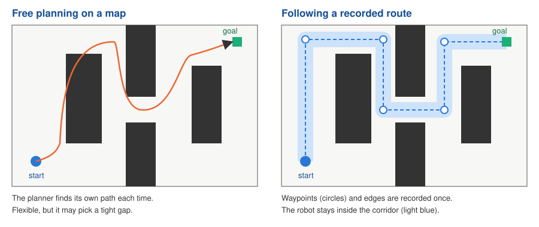

This page collects **how companies and researchers make robots walk through buildings**: to a goal, around
furniture, through narrow gaps and among people. It was put together on 17 November 2026 for a Unitree G1
humanoid in a lab hall. Five questions were researched, and the key claims were checked against the
original pages. The page lists **every improvement that turned up**, not a selection, and every part ends
with its sources.

It is written for someone who has not worked on robot navigation before.

---

## What is robot navigation?

A robot that walks to a place in a building has to answer three questions all the time:

| Question | Name | What usually answers it |
|---|---|---|
| Where am I? | Localisation | A laser scanner (LiDAR) and a stored map |
| How do I get there? | Planning | A planner that searches the map for a path |
| What do I do right now? | Control | A controller that turns the path into speed commands, and a walking controller that turns those into steps |

The standard open software for the second and third question is **Nav2**, part of ROS 2, the common
software framework for robots. Our robot uses Nav2 on top of a learned walking controller. That overall
pattern, a planner on top of a learned walking controller, is also what commercial walking robots use.
The differences are in the details below.

## At a glance

| Part | Question |
|---|---|
| [Routes and waypoints](#routes) | How do commercial robots choose where to walk? |
| [Tight spaces](#tight-spaces) | How do robots get through narrow gaps and avoid getting stuck? |
| [People](#people) | How do robots behave around walking people? |
| [Learned navigation](#learned) | What has machine learning added, and does it replace maps and planners? |
| [Localisation and maps](#localisation) | How does the robot know where it is, and what map does it use? |

## Every improvement found, in one table

"Effort" is our own estimate for this setup: **small** = a settings change, **medium** = a new component to
set up and test, **large** = a project of its own. "Evidence" says how well the benefit is shown in the
sources: **strong** = official documentation or peer-reviewed results, **medium** = preprints or the
authors' own tests, **weak** = single small tests, blogs or marketing.

### Choosing where to walk

| Improvement | What it does | Who uses it | Effort | Evidence |
|---|---|---|---|---|
| Recorded route graph | The robot follows waypoints and edges recorded once, inside a corridor | Spot (GraphNav), ANYmal | medium | strong |
| Nav2 Route Server | The same idea inside Nav2: a graph of routes replaces or guides free planning | Nav2, since release Kilted (2025) | medium, needs a newer Nav2 | strong |
| Waypoint follower | Visit a list of goals in order, with a task at each | Nav2, in our release | small | strong |
| Keepout and speed zones | Mark areas the robot must not enter, or must cross slowly | Nav2 | small | strong |
| Fleet standard VDA 5050 | One language between robots of different makers and a fleet manager | Warehouse robot makers | not needed for one robot | medium |

### Tight spaces and getting stuck

| Improvement | What it does | Who uses it | Effort | Evidence |
|---|---|---|---|---|
| Real footprint instead of a circle | The planner knows the robot is narrower one way than the other | Nav2 | small | strong |
| Footprint-aware planners | Smac Hybrid-A* and State Lattice plan with the real shape; Smac 2D assumes a circle | Nav2 | small to medium | strong |
| Sideways motion (omnidirectional MPPI) | The controller may command sideways steps | Nav2 | small | strong |
| Wide, smooth safety margin | Routes stay in the middle of aisles | Nav2 tuning advice | small | strong |
| Rotation Shim | Turn towards the path first, then walk | Nav2 | small | strong |
| Custom recovery behaviours | Replace "spin and back up" with moves the robot can do | Nav2 behaviour trees | medium | strong that it is possible; no published recipe for a robot that cannot reverse |
| Learned model of the robot's real motion in the planner | The planner predicts what the robot will really do, not what was commanded | ANYmal, Vision 60 and biped research | large | medium to strong |
| Whole-body planning in clutter | The robot crouches, turns or squeezes through | Research on ANYmal and humanoids (2024 to 2026) | large | medium |
| Newer Nav2 releases | Side-biased safety margin, acceleration limits per direction, delay compensation | Nav2 Jazzy, Kilted, Lyrical | medium (new Ubuntu and ROS release) | strong |

### People

| Improvement | What it does | Who uses it | Effort | Evidence |
|---|---|---|---|---|
| Collision Monitor | Filters the speed command: stop zone, slow zone, minimum time to collision | Nav2, in our release | small | strong |
| Safety-rated laser scanners | Certified sensors with protective fields that grow with speed | Industrial mobile robots | large (hardware) | medium |
| Social costmap layers | Extra cost around detected people, more in front of them | Research add-ons for Nav2 | medium | weak to medium |
| People detection and tracking | Find and follow people in LiDAR or camera data | Research add-ons | medium to large | weak to medium |
| Predicting people's paths | Plan around where a person will be | Research | large | medium |
| Learned social navigation | A trained policy that moves among people | Research | large | weak in real deployments |
| People simulators | Test with simulated walking people (HuNavSim) | Research | medium | strong that it exists; simulation does not replace tests with people |
| Fall-aware safety rules | Stability limits, fall detection, controlled descent | Draft standard ISO 25785-1 | to follow, not to build | weak (draft) |

### Learned navigation

| Improvement | What it does | Who uses it | Effort | Evidence |
|---|---|---|---|---|
| A model picks the goal, a planner drives | Language or vision model chooses the destination; classical code does the path | Mobility VLA (Google) | medium | medium |
| Language to mid-level commands | A model turns an instruction into "forward 75 cm" style steps for a walking policy | NaVILA | large | medium (authors' own tests) |
| Visual navigation foundation models | Navigate from camera images without a map | GNM, ViNT, NoMaD | large | weak: a third-party test found frequent collisions |
| Open-vocabulary maps | A map that knows object names, feeding a normal planner | HOV-SG | large | medium |
| End-to-end humanoid models | One network from camera to joints | Company demos, 2026 preprints | not realistic here | weak |

### Localisation and maps

| Improvement | What it does | Who uses it | Effort | Evidence |
|---|---|---|---|---|
| Global matcher without a start pose | Finds the robot on the stored map from one scan (KISS-Matcher), then fine tracking (small_gicp) | Research, open source | medium | medium |
| Scan-to-map tracking with a manual start pose | Classic approach (NDT, GICP) | Open-source ROS 2 packages | medium | medium |
| Other LiDAR odometry | FAST-LIO2, KISS-ICP, GLIM instead of DLIO | Open source | medium | weak: no clear winner |
| Leg-aware or vibration-aware odometry | Uses the legs' motion or models the shaking | Research | large | medium |
| The robot maker's own mapping service | Unitree documents a mapping and navigation service for its robots | Unitree | small to try | weak: details not readable |
| 3D obstacle layers | Keep height information for obstacles (voxel layer, STVL) | Nav2 | medium | strong |
| Removing moving things from the map | Cleans people and moved furniture out of a stored map | Research tools | medium | medium |
| Handling glass | Detect reflections and remove ghost points | Research | medium to large | weak |

## Not found

Things we looked for and could not find published:

* how commercial fleets (warehouse, hospital, restaurant robots) plan internally;
* an escape strategy for a robot that cannot walk backwards;
* navigation built on the walking controller we use (GEAR-SONIC);
* a fair test where a learned navigation model beats a tuned classical planner on a real humanoid;
* the exact safety distances industrial standards require.

---

## Routes and waypoints: how commercial robots choose where to walk {#routes}

There are two ways to tell a robot where to walk. **Free planning** hands the robot a map and a goal and
lets a planner find any path. **Route following** records the paths once, as a chain of waypoints, and the
robot stays on them. We started with free planning. The commercial walking robots mostly follow routes.

### What companies do

#### Spot (Boston Dynamics): a recorded graph

Spot's navigation system is called GraphNav. Its developer documentation describes it [1][2]:

| Part | How it works |
|---|---|
| The map | A graph of **waypoints** joined by **edges**. Each waypoint stores a snapshot of what the sensors saw there. There is no single global map frame. |
| Recording | A person drives the robot through the building once. |
| Knowing where it is | The robot's position is given relative to a waypoint. To start, it is placed near a printed marker that was seen during recording, or its position is set by hand. |
| Walking | It moves from waypoint to waypoint and has to stay inside a corridor around each edge. |
| Obstacles | It can go around an obstacle, but stays close to the recorded route. If it gets too far from the route, it reports itself as stuck. |
| Choosing a route | The program can ask for a destination waypoint and let the robot pick the route, or hand over an exact route. |
| Special edges | An edge can carry extra information, for example that it goes over stairs. |

Stated limits: the robot does not recover by itself when it has lost its position, and its position
estimate gets worse in places with few features or where the room has changed.

Spot's walking itself combines a learned policy with a model-based controller [3].

#### ANYmal (ANYbotics)

ANYmal's specification sheet describes waypoints that the operator defines and edits in a program, with the
robot taking the shortest route between them [4]. We saw this only as a search result, not the full sheet.

#### Warehouse and service robots

Amazon's Proteus moves freely among employees and uses several kinds of sensors together; how it plans is
not published [5]. For the other makers we looked at (MiR, OTTO, Locus, Keenon, Bear Robotics) nothing
public describes the planner. Robots from different makers talk to a fleet manager through a common
standard called VDA 5050.

### The same ideas in Nav2

Nav2 is the navigation software we use. It has several route and waypoint tools, some in our release
(Humble, 2022), some only in newer ones.

| Tool | What it does | In our release? |
|---|---|---|
| **Waypoint Follower** | Takes a list of goals and visits them in order. A plug-in can do a task at each one, such as waiting. One setting decides whether a failed waypoint stops the whole list. Nav2 calls it a sample application: fine for simple tours, while a larger system would use its own mission logic [6]. | Yes |
| **Navigate through poses** | One trip through several poses without stopping at each. | Yes |
| **Keepout zones** | Areas painted on the map that the planner never enters. | Yes |
| **Speed zones** | Areas where the speed limit is lower. | Yes |
| **Route Server** | A graph of nodes and edges, written by hand or generated, stored as a GeoJSON file. It can replace free planning where the robot must follow a route closely, or guide the planner over long distances. Edges can be scored by distance, time or how blocked they are; a blocked edge can be closed so the robot takes another. Things can be triggered at a node or on entering an edge, such as a speed limit. Named uses: route following, several floors, and teach-and-repeat [7]. | No. First in Kilted (2025) [8] |

### What each approach is good and bad at

| | Free planning | Recorded routes |
|---|---|---|
| Setting it up | Needs only the map | Someone has to record or draw the routes |
| New goals | Any free point on the map | Only places on the graph (or a short free stretch from the nearest waypoint) |
| Narrow places | The planner may choose a gap the robot barely fits | The route was chosen by a person who knew it fits |
| Furniture moved | Finds a new path by itself | May be blocked; needs another edge or a short detour |
| Predictability | The path differs from run to run | People in the building learn where the robot walks |
| Our experience | Got stuck between chair rows with a circular footprint | Not tried yet |

### Options for our robot

These are options, from least to most work:

1. **Waypoint list with the tools we have.** Mark a handful of named places in the hall (door, counter,
   stage, chairs) and send them as a list. This is "setting the goal" in its simplest form.
2. **Keepout zones** around the areas the robot should never enter, such as the chair rows during an
   event. Free planning then works in the rest.
3. **A hand-drawn route graph**, used with free planning: plan freely to the nearest node, follow the
   graph, plan freely for the last stretch. Possible in our release with some own code.
4. **Nav2's Route Server**, which does option 3 properly. It needs a newer Nav2, which means a newer
   Ubuntu and ROS 2 release on the navigation computer.
5. **Record instead of draw:** walk the robot through the hall by remote control once and turn the walked
   path into the graph, as Spot does.

### Sources

1. Boston Dynamics, GraphNav Technical Summary. <https://dev.bostondynamics.com/docs/concepts/autonomy/graphnav_tech_summary> (developer documentation)
2. Boston Dynamics, GraphNav Service. <https://dev.bostondynamics.com/docs/concepts/autonomy/graphnav_service> (developer documentation)
3. Boston Dynamics, Starting on the Right Foot with Reinforcement Learning. <https://bostondynamics.com/blog/starting-on-the-right-foot-with-reinforcement-learning/> (company blog)
4. ANYbotics, ANYmal technical specifications. <https://www.anybotics.com/anymal-technical-specifications.pdf> (specification sheet; seen as a search result only)
5. The Robot Report, How Amazon developed precision autonomy for Proteus, 31 August 2022. <https://www.therobotreport.com/how-amazon-developed-precision-autonomy-for-proteus/> (news)
6. Nav2 Waypoint Follower, README for Humble. <https://github.com/ros-navigation/navigation2/blob/humble/nav2_waypoint_follower/README.md> (documentation)
7. Nav2 Route Server, README. <https://github.com/ros-navigation/navigation2/blob/main/nav2_route/README.md> (documentation)
8. Nav2 Kilted Release, 2 June 2025. <https://discourse.openrobotics.org/t/nav2-kilted-release/44079> (maintainer's announcement)

---

## Tight spaces: narrow gaps and getting stuck {#tight-spaces}

A walking robot is not a circle, does not move exactly as commanded, and often cannot step backwards. All
three matter in narrow places. This page lists what the navigation software offers for that, what
researchers have added, and what nobody has published.

### What we saw ourselves

In simulation, with the robot described to the planner as a circle 0.64 m wide, it could not pass gaps a
person would walk through. Once its centre came closer to an obstacle than its radius, every plan, turn and
back-up was refused and it stood still. Described by its real shape, about 0.34 m deep and 0.48 m wide,
and allowed to step sideways, it passed the same places. Its hands then brushed obstacles a few times,
because they stick out past that width.

### What Nav2 offers

| Feature | What it does | Note |
|---|---|---|
| **Footprint instead of radius** | The robot is described by its outline, not a circle | Available in our release |
| **Footprint checking in the MPPI controller** | The controller tests the whole outline against obstacles. It is **switched off by default**, in which case only the centre point is tested [1] | Easy to miss |
| **Omnidirectional model in MPPI** | The controller may command sideways motion; a setting gives the highest sideways speed [1] | Available in our release |
| **Controller time step** | MPPI's time step has to match how often the controller runs, or it will not start [1] | We hit this |
| **Smac Hybrid-A\* and State Lattice planners** | Plan with the real outline and with how the robot can actually move. The planner we use, Smac 2D, is meant for round robots. The Hybrid planner lists walking robots as supported, and the Lattice planner comes with motion sets for them [2] | A stronger fix than our current one |
| **Smooth, wide safety margin** | The planner documentation advises spreading the cost far from obstacles, so paths run down the middle of aisles [2] | We did this |
| **Rotation Shim** | Turns the robot towards a new path before it starts walking. Useful with simple planners, unnecessary with the footprint-aware ones [3] | Needs a robot that turns on the spot |
| **Recovery behaviours** | By default: clear the obstacle map, turn about 90 degrees, wait five seconds, back up 30 cm, up to six tries [4]. The list is a file that can be replaced by your own | Two of the four do not suit a robot that cannot reverse |

Newer Nav2 releases add more. Jazzy (2024) made MPPI about 45 % faster and added acceleration limits [5].
Lyrical (August 2026) added, for MPPI, a model of the robot's dynamics, different acceleration limits per
direction and compensation for delay, plus a safety margin that prefers passing on one side [6]. Different
limits per direction is what a robot that walks forwards well and backwards not at all needs.

### The robot does not move as commanded

Our robot reaches about three quarters of the commanded forward speed and lags in turns. The planner
assumes the command is carried out exactly, so its predictions are off. Research groups handle this by
teaching the planner how the robot really responds:

| Work | Robot | What they did | Reported result |
|---|---|---|---|
| Learned forward dynamics in MPPI (RSS 2025) [7] | ANYmal (four legs) | A learned model predicts where the robot will really be | Position predicted 41 % better; 27 % more goals reached in rough simulated terrain |
| Neural observer-predictor in MPPI (2025) [8] | Vision 60 (four legs) | A learned model predicts the whole body, so collisions are checked per limb | Passed a narrow passage; no numbers in the summary |
| Koopman model with predictive control (2024) [9] | A two-legged robot | A simple learned model of the walking policy's response to speed commands | More successes in narrow passages |

No source gives a simple rule such as "add this much margin for a robot that reaches 80 % of the command".

### Robots that squeeze through

Some research goes further and lets the robot change its posture:

* **Confined spaces with a four-legged robot (ICRA 2024)** [10]: a two-level learned controller that uses a
  3D picture of the surroundings to pass under and between obstacles.
* **PASSAGE (September 2026)** [11]: a planner paired with a whole-body controller that sees its
  surroundings, on a Unitree G1. In simulation on unseen layouts, 98.7 % of runs reached the goal and
  70.3 % did so without touching anything. On the real robot, 50 of 50 runs reached the goal and 45 were
  free of contact. These are the authors' own results.
* **HumanoidPF and FocusNav (January 2026)** [12]: humanoid navigation through narrow passages; FocusNav
  runs on a G1.

These are research systems trained on large amounts of motion data, not settings one can switch on.

### Someone did the same thing we did

A public project, `rl_hnav` from a university robotics group, runs Nav2 with a learned walking policy for
the Unitree G1 in the MuJoCo simulator [13]. A small bridge program limits and smooths the speed command
and stops the robot when commands stop arriving. The project reports no test results.

### Not found

* A published way to free a robot that is stuck and cannot walk backwards.
* What Nav2's planners do when the robot already stands inside an obstacle's margin; the documentation
  does not say for our release.

### Options for our robot

1. Widen the footprint by a few centimetres to cover the hands, or hold the arms closer.
2. Try the Hybrid-A\* or Lattice planner, which plan with the real shape from the start.
3. Write an escape behaviour that fits the robot: turn towards the open side, step sideways, walk out.
4. Measure how the robot really responds to speed commands and tell the controller, first as simple limits,
   later perhaps as a learned model.
5. Move to a newer Nav2 for per-direction limits and delay compensation.

### Sources

1. Nav2 MPPI controller, README for Humble. <https://github.com/ros-navigation/navigation2/blob/humble/nav2_mppi_controller/README.md>
2. Nav2 Smac planner, README for Humble. <https://github.com/ros-navigation/navigation2/blob/humble/nav2_smac_planner/README.md>
3. Nav2 Rotation Shim controller, README for Humble. <https://github.com/ros-navigation/navigation2/blob/humble/nav2_rotation_shim_controller/README.md>
4. Nav2 default behaviour tree with recovery, Humble. <https://github.com/ros-navigation/navigation2/blob/humble/nav2_bt_navigator/behavior_trees/navigate_to_pose_w_replanning_and_recovery.xml>
5. Nav2 Jazzy Release, 24 June 2024. <https://discourse.openrobotics.org/t/nav2-jazzy-release/38321>
6. Nav2 Lyrical Release and Key Features, 25 August 2026. <https://discourse.openrobotics.org/t/nav2-lyrical-release-key-features/57666>
7. Learned perceptive forward dynamics with MPPI, 2025. <https://arxiv.org/abs/2504.19322>
8. Neural observer-predictor models with MPPI, 2025. <https://arxiv.org/abs/2510.22789>
9. Koopman-based safe navigation for bipedal robots, 2024. <https://arxiv.org/abs/2409.14736>
10. Miki et al., Learning to walk in confined spaces using 3D representation, 2024. <https://arxiv.org/abs/2403.00187>
11. PASSAGE, 2026. <https://arxiv.org/abs/2609.18732>
12. HumanoidPF, 2026. <https://arxiv.org/abs/2601.16035>; FocusNav, 2026. <https://arxiv.org/abs/2601.12790>
13. rl_hnav. <https://github.com/uleroboticsgroup/rl_hnav>

---

## People: how robots behave around walking visitors {#people}

A robot in a hall with visitors has to do two things: not walk into anyone, and behave in a way people
find normal. The first is safety engineering with standards behind it. The second is a research field
called social navigation. This page covers both.

### The engineering answer: filter the speed command

Whatever the planner decides, a last check sits between it and the motors. Nav2 ships this as the
**Collision Monitor**, and it is in our release [1]. It watches the sensor data inside shapes drawn around
the robot:

| Zone type | What happens when something is inside |
|---|---|
| **Stop** | The robot stops |
| **Slowdown** | The speed is cut to a set share |
| **Approach** | The speed is reduced so that a set time to collision always remains |

If several zones react, the strictest wins. The third type scales with the robot's own speed, which fixed
distances do not. Newer Nav2 releases let the zones change shape with speed (Jazzy, 2024) [2] and add
zones that are ignored on purpose (Lyrical, 2026) [3].

Industrial mobile robots do the same with **certified safety laser scanners**, whose protective fields
grow with speed. The stopping distance is worked out from how fast a person may approach and how long the
robot needs to stop. We did not manage to read the numbers the industrial standards require.

### Safety standards for walking robots

| Standard | What it covers | Status |
|---|---|---|
| ISO 13482 | Personal care robots, including mobile servant robots: safe stopping, speed limits that depend on the task | Published 2014; numbers not read |
| ISO 3691-4, ANSI R15.08 | Industrial mobile robots | Published; they do not cover robots that balance |
| **ISO 25785-1** | Industrial mobile robots that balance actively: legged and two-legged robots | **A draft.** Its comment period closed in July 2026; the current stage is not confirmed [4] |

A commentary on an earlier draft of ISO 25785-1 expects it to ask for limits on stability, detecting a
fall, a controlled way of going down, and lower speed near people [5]. That is one author's reading of a
draft, not the final text. The point for a humanoid is that **the robot can fall**, and a falling 35 kg
robot is itself the hazard. Stopping is only safe if the robot stays standing when it stops.

### Social navigation research

#### Method families

| Family | Idea | Known weakness |
|---|---|---|
| Reactive (social forces, ORCA) | People and robot push each other away like magnets | Ignores how the robot can actually move, which matters for a slow robot that cannot reverse |
| Prediction plus planning | Predict each person's path, then plan around it | If prediction and planning are separate, the robot can decide every path is unsafe and freeze |
| Learned policies (reinforcement learning) | Train a policy among simulated people | Works in simulation; moving to real robots stays hard [6] |
| Learning from demonstrations | Copy how people drove a robot through crowds | Depends on the demonstrations that were collected |
| Hybrid | A classical planner most of the time, a learned one where it helps | Most promising in the tests we found |

#### What the evidence says

* A 2024 study compared classical planners with human demonstrations of driving through public places.
  The classical planners matched what the humans did in most situations, up to 80 % of them. A hybrid that
  switched between a classical and a learned planner scored best in most, but not all, of the tests on two
  real robots [7].
* A late-2025 survey of learned social navigation reports that moving from simulation to real robots is
  still a problem, and that the field has no agreed way of measuring success [6].
* We found **no real deployment** in which a learned social policy clearly beats a well-tuned classical
  one. That is "not found", not "proven impossible".

#### How to measure it

A large group of researchers published guidelines for evaluating social navigation [8]. They recommend
reporting three kinds of results:

* the usual ones: goals reached, time, path length, collisions;
* social ones: how close the robot came to people and for how long;
* what people say in questionnaires.

They also state that simulation is useful for finding problems but does not replace tests with real
people. As an illustration they use the distances from the study of personal space: about 0.45 m as
intimate and 1.2 m as personal. These are illustrations, not required thresholds.

#### Tools

* **HuNavSim**: an open simulator of walking people for ROS 2, with several behaviours (for example people
  who ignore the robot, or who are curious about it) and built-in measurements [9].
* **Social costmap layers** and **people trackers** for Nav2 exist as research add-ons, for example with a
  3D LiDAR and a depth camera together. We did not check whether they are maintained.

### What we have so far

Our simulator now has walking people (cylinders at 1.0 to 1.4 m/s that cross the robot's path) and a
hand-written stop and slow zone. Our people still crowd the robot more than real visitors would, so the
first numbers need care.

### Options for our robot

1. Replace the hand-written zone with Nav2's Collision Monitor, including the time-to-collision zone.
2. Work out the stop distance from measurements: how long the robot needs to come to a stand from a stop
   command, and how fast a visitor approaches.
3. Report the measures from the guidelines: closest distance, time closer than 0.45 m and 1.2 m, stops,
   and how long the robot stays blocked.
4. Use HuNavSim's people models instead of our own simple ones.
5. Add a social cost layer around detected people only if the simpler set-up still comes too close.
6. On the real robot: slow walking, a person with an emergency stop, and a check that stopping leaves the
   robot standing.

### Not found

* The distances and speeds industrial standards require.
* How commercial service robots behave when a person blocks them.
* Any standard specifically for humanoids in public spaces.

### Sources

1. Nav2 Collision Monitor, README for Humble. <https://api.nav2.org/nav2-humble/html/md_nav2_collision_monitor_README.html>
2. Nav2 Jazzy Release, 24 June 2024. <https://discourse.openrobotics.org/t/nav2-jazzy-release/38321>
3. Nav2 Lyrical Release and Key Features, 25 August 2026. <https://discourse.openrobotics.org/t/nav2-lyrical-release-key-features/57666>
4. ISO/CD 25785-1. <https://www.iso.org/standard/91469.html> (status seen through a national standards body's listing)
5. i-Scoop, ISO 25785-1 explained. <https://www.i-scoop.eu/iso-25785-1-explained-and-what-it-means-for-humanoid-robot-safety/> (commentary)
6. Socially aware navigation: a survey on deep reinforcement learning approaches, 2025. <https://arxiv.org/abs/2512.00049>
7. Raj et al., Rethinking Social Robot Navigation, 2023 (ICRA 2024). <https://arxiv.org/abs/2309.13466>
8. Francis et al., Principles and Guidelines for Evaluating Social Robot Navigation, 2023. <https://arxiv.org/abs/2306.16740>
9. HuNavSim, 2023. <https://arxiv.org/abs/2305.01303>

---

## Learned navigation: what machine learning has added {#learned}

Since about 2022, many groups have trained neural networks to navigate: from camera images, from spoken
instructions, sometimes with no map at all. This page lists the main kinds, what they were tested on, and
how they compare with the classical approach of map, planner and controller.

### The kinds of learned navigation

| Kind | Input | Output | Examples |
|---|---|---|---|
| **Visual navigation foundation models** | Camera images and a picture of the goal | Short-range waypoints or speeds | GNM, ViNT, NoMaD |
| **Vision-language navigation** | Camera images and an instruction in words | Mid-level steps or speeds | NaVILA, NavFoM |
| **A language model that only picks the goal** | A video tour of the building and a request | A destination; a classical planner drives | Mobility VLA |
| **Learned local policies** | Sensor data around the robot | Speed commands | X-Mobility, COMPASS |
| **Maps that know object names** | 3D scans with image features | A map a normal planner can use, searchable by words | HOV-SG |
| **End to end for humanoids** | Camera images | All joint commands | Company demos, 2026 preprints |

### What was tested, and how well it did

#### NaVILA: instructions for legged robots

A vision-language model reads the camera and an instruction and writes out a small step in words, such as
moving forward by 75 cm. That is turned into a speed command, and a separate learned walking policy
carries it out. The language model runs at about one decision per second on a strong graphics card. In the
authors' own real-world tests, 25 instructions repeated three times on a four-legged robot and a small
humanoid, it succeeded in 88 % [1].

#### Visual navigation foundation models, tested by others

A study from March 2026 took five such models (GNM, ViNT, NoMaD and two more) and tried them, without
extra training, on two robots in five places. It reports frequent collisions, confusion between places
that look alike, and worse results with blur or glare [2].

#### Mobility VLA: the model picks the goal, classical code drives

A large language model watches a recorded tour of the building and picks the frame that matches a request.
A classical graph built from the tour then produces the path. It found the right goal in 86 % and 90 % of
requests in two settings, and completed 80 % and 85 % of real-world runs from start to finish. When the
model was asked to produce the path itself in simulation, it failed every time [3].

#### COMPASS: one policy for many robots

A learned local policy is adapted to each robot type with further training. It outputs speed commands; on
humanoids a learned walking policy carries them out. Its gains are measured against the same group's
earlier learned policy, not against a classical planner [4].

#### Learned against classical, on a real robot

One small study put a simple classical method (a potential field) and learned policies on the same
wheeled robot in a hallway. The classical method succeeded on a straight stretch, around a corner and
with a person walking by, and failed in a confined space, where one learned policy succeeded in four of
five tries. The classical method was run only once per situation, so this is an anecdote, not a
measurement [5].

#### The BARN challenge

A yearly competition on driving through tightly packed obstacles. Its organisers wrote in 2022 that
navigation in very constrained spaces is far from solved [6]. On the 2026 results page, the top four
scores in simulation lie within 0.01 of each other [7]; we could not read which methods the winners used.

### Where each side wins

| Situation | Better choice, on the evidence found |
|---|---|
| A known building with a stored map | Classical planner |
| Reaching an exact pose | Classical planner |
| Predictable behaviour that can be explained | Classical planner |
| A goal given in words ("go to the kitchen") | A language or vision model, to pick the goal |
| A place never seen before, no map | Learned navigation |
| Very tight spaces | Unsolved for both; some learned results look better |

The two best-supported learned systems above both keep a structured layer underneath: a separate walking
policy in one, a classical graph in the other. Neither goes from camera to motion in one step.

### Not found

* Published navigation work built on the walking controller we use (GEAR-SONIC). Its planner takes speed
  and direction commands, so a navigation layer has to be added, as we did.
* A fair comparison of a learned navigation model with a tuned Nav2 on a real humanoid.

### Options for our robot

1. **Keep the classical planner on the stored map** and let a language model choose the goal from the
   labelled objects on the map. This is the Mobility VLA pattern.
2. **A map that knows object names**, if goals should be found that nobody labelled.
3. **A one-day comparison** of our set-up with one open learned policy on the same goals in simulation:
   goals reached, contacts, time, at least five repeats each.
4. **A language model that gives step-by-step commands**, as NaVILA does, only if instructions should work
   in places without a map.

### Sources

1. NaVILA, 2024. <https://arxiv.org/abs/2412.04453>
2. Can Vision Foundation Models Navigate?, 2026. <https://arxiv.org/abs/2603.25937>
3. Mobility VLA, 2024. <https://arxiv.org/abs/2407.07775>
4. COMPASS, 2025. <https://arxiv.org/abs/2502.16372>
5. Are Learning-Based Approaches Ready for Real-World Indoor Navigation?, 2025. <https://arxiv.org/abs/2507.04086>
6. Autonomous Ground Navigation in Highly Constrained Spaces: Lessons learned from the BARN Challenge, 2022. <https://arxiv.org/abs/2208.10473>
7. The BARN Challenge 2026, results page. <https://people.cs.gmu.edu/~xiao/Research/BARN_Challenge/BARN_Challenge26.html>

---

## Localisation and maps: knowing where the robot is {#localisation}

To walk to a place on a map, the robot needs three things: a smooth estimate of its own motion
(odometry), its position on the stored map (localisation), and a map of where it may walk. This page lists
the options for each, for a walking robot with a Livox Mid-360 LiDAR in its head.

### Odometry from the LiDAR

Several open programs turn LiDAR and motion-sensor data into the robot's motion. We use DLIO.

| Program | In short |
|---|---|
| **DLIO** | What we use. Its paper reports less computing and better accuracy than earlier methods [1] |
| **FAST-LIO2** | Used as the baseline in the legged-robot paper below |
| **KISS-ICP** | Was the least steady of the three in the test below |
| **GLIM** | Uses a graphics card and corrects its path when it returns to a known place |
| **Point-LIO, LIO-SAM, iG-LIO, FAST-LIVO2** | Further programs named in comparisons; not looked at in detail |

There is **no clear winner**. One test on the same LiDAR and the same class of onboard computer as ours,
on seven indoor drone flights, measured an average error of about 10 cm for DLIO, 11 cm for FAST-LIO2 and
12 cm for KISS-ICP, with GLIM at 4 cm on a graphics card [2]. It is a single forum post about a drone,
not a walking robot. On other data sets the order changes.

For walking robots, which shake at every step, the evidence is thin:

* one method adds the legs' own motion to LiDAR and motion sensor on a two-legged robot [3];
* one models how vibration blurs each scan and weights the points accordingly [4].

We found no comparison of these programs on a humanoid with our LiDAR.

**The robot maker's own service.** Unitree's documentation lists a mapping and navigation service for its
robots, with commands to start and stop mapping, set the start position and walk to a pose [5]. We could
not read the page itself, only a copy, so the details are unconfirmed. Our LiDAR recorder already listens
for that service's position messages and has received none so far.

### Finding the robot on the stored map

Odometry starts at zero every time. Localisation matches the current scan against the stored map.

| Approach | Needs a start position? | Notes |
|---|---|---|
| **Scan-to-map tracking** (NDT, GICP, small_gicp) | Yes, roughly right | Fast and accurate once started. Open ROS 2 packages exist. Fails if the start is far off |
| **Global registration** (KISS-Matcher) | **No** | Finds the pose from one scan. With a fine-matching step afterwards, its error fell from about 18 cm to about 1 cm, measured on outdoor driving data [6] |
| **Place descriptors** (Scan Context and others) | No | Recognise a place by a compact signature of the scan |
| **2D localisation on a flattened scan** (AMCL) | Yes | The classic for wheeled robots; throws away the height information |
| **Printed markers** | No | What Spot uses to start: stand near a marker seen during recording |

A described recipe combines two of these: a global match for the first position, then fast tracking, with
exactly one program publishing the result. Two programs publishing it at once make the position jump [7].
That description is a blog post without measurements.

Our own simulation had found that tracking survives moved furniture but cannot recover from a start more
than about half a metre and ten degrees off. A global matcher removes that limit.

### Maps that stay valid

A stored map goes out of date when furniture moves, and it contains whatever stood there during the scan.

| Problem | What exists |
|---|---|
| **People and moved things in the map** | Programs that remove moving points from a recorded map: Removert, ERASOR, Dynablox, DUFOMap. A comparison found each trades off differently between keeping the fixed structure and removing what moved [8]. Tested mostly on outdoor driving data |
| **Glass and reflections** | Research that detects reflecting planes and removes the ghost points behind them. Not tested on our kind of LiDAR |
| **A changing room** | Keep only what appears in several scans taken on different days, which is what we did by hand |

### From 3D points to a map the planner can use

Nav2 plans on a flat grid. There are several ways to feed it from a 3D LiDAR:

| Way | What it does |
|---|---|
| **Flatten to a 2D scan** | Take the points in a height band and treat them as one flat scan. Simple; what our simulation does |
| **Voxel layer** | Keeps obstacles in a coarse 3D grid and projects them down. Clears old obstacles by tracing rays; that has to be switched on for each sensor [9] |
| **Spatio-Temporal Voxel Layer** | Obstacles fade out after a set time instead of being cleared by rays. Made for 3D sensors and moving things |
| **Height maps** | Store the ground height per cell; used by legged robots on rough ground |

Things to set by hand: the height band (above the floor, below the ceiling), how fast moved obstacles
disappear, and a blind zone around the robot so it does not see its own body.

**Has anything replaced the flat map?** In research, yes: 3D grids, meshes and learned scene models are
used for planning, and one 2026 humanoid paper argues that height maps lose overhangs. In practice, for
navigation of the kind Nav2 does indoors, we found no sign that the flat map has been replaced.

### Options for our robot

1. Keep DLIO for odometry. Compare it once with FAST-LIO2 on a recorded walk if it struggles on the robot.
2. For the position on the stored map, try the global matcher followed by fine tracking; fall back to
   tracking with a start position set by hand.
3. Check on the robot whether Unitree's own mapping service is installed, since it would need no work.
4. Feed the planner through a 3D obstacle layer with fading, so people and moved chairs disappear again.
5. Clean people and one-day clutter out of the stored map with one of the removal programs, and compare
   with our by-hand result.
6. Mark glass walls by hand, in the stored map and in the live data.

### Not found

* A comparison of odometry programs on a humanoid with this LiDAR.
* How fast the matchers run on the robot's onboard computer.
* Tested handling of glass for this LiDAR.

### Sources

1. Direct LiDAR-Inertial Odometry (DLIO), 2022. <https://arxiv.org/abs/2203.03749>
2. SLAM benchmark on Livox Mid-360, forum post, 7 September 2026. <https://discourse.openrobotics.org/t/slam-benchmark-on-livox-mid-360-public-dataset-our-own-uav-flight-data-kiss-icp-dlio-fast-lio2-glim/57912>
3. LIKO: LiDAR, inertial and kinematic odometry for bipedal robots, 2024. <https://arxiv.org/abs/2404.18047>
4. Vibration-aware LiDAR-inertial odometry, 2025. <https://arxiv.org/abs/2507.04311>
5. Unitree, SLAM and Navigation Services Interface. <https://support.unitree.com/home/en/developer/SLAM%20and%20Navigation_service> (content seen only through a copy)
6. KISS-Matcher, 2024. <https://arxiv.org/abs/2409.15615>
7. From blind startup to global relocalization, blog post. <https://dev.to/_pipo/from-blind-startup-to-global-relocalization-building-a-ros-2-3d-lidar-navigation-system-dho>
8. A dynamic points removal benchmark in point cloud maps, 2023. <https://arxiv.org/abs/2307.07260>
9. Nav2 voxel layer. <https://docs.nav2.org/configuration/packages/costmap-plugins/voxel.html>
